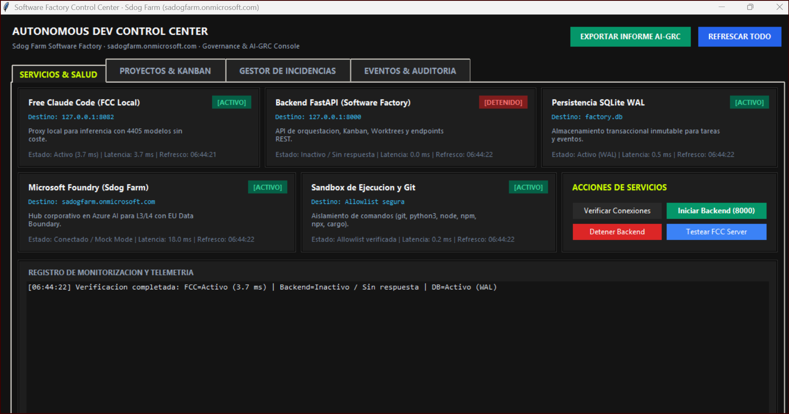
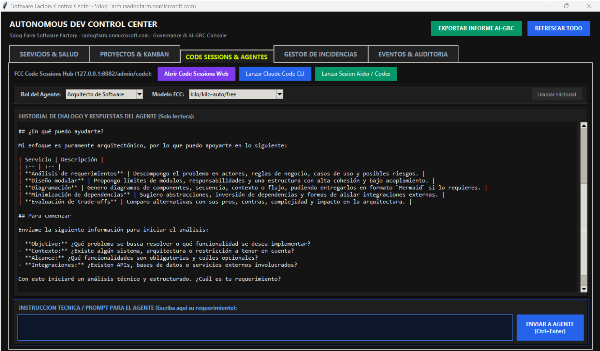

# Autonomous Dev Console · Console AI Dev Infrastructure

Consola de Gestion Integral de Escritorio para Windows para la gobernanza, telemetria, ciclo de vida Kanban, resolucion de incidencias y auditoria forense de la Factoria de Software con Inteligencia Artificial (*Autonomous AI Dev Infrastructure*).

Organizacion: **Sdog Farm Software Factory** (`sadogfarm.onmicrosoft.com`)  
Repositorio Principal: [https://github.com/SADOCKDOG/Console-AI-Dev-Infrastructure](https://github.com/SADOCKDOG/Console-AI-Dev-Infrastructure)

---

## 1. Proposito y Alcance

Esta aplicacion de escritorio nativa para Windows proporciona a directores tecnicos, operadores de infraestructura y auditores normativos un panel de control desacoplado, reactivo y de alta disponibilidad para:
- Monitorizar en tiempo real los servicios de la factoria (FCC Server, FastAPI Backend, SQLite WAL, Microsoft Foundry, Sandboxes).
- Supervisar el tablero Kanban de proyectos satelite como *Livestock Manager*.
- Ejecutar la barrera de aprobacion humana obligatoria (AI-GRC Gate) para promover tareas a `DONE`.
- Registrar, diagnosticar y resolver incidencias tecnicas o bloqueos normativos con trazabilidad forense.
- Exportar informes integrales de auditoria y cumplimiento en formato Markdown.

---

## 2. Repositorios y Proyectos Relacionados

La consola opera de forma integrada con el ecosistema de la factoria de software:

- **Infraestructura de Factoria de Software:** [Autonomous-AI-Dev-Infrastructure](https://github.com/SADOCKDOG/Autonomous-AI-Dev-Infrastructure)
  - Provee el backend FastAPI en el puerto 8000, los agentes de LangGraph, la base de datos `factory.db` y las politicas AI-GRC.
- **Proyecto Piloto Supervisado:** [LIVESTOCK-MANAGER](https://github.com/SADOCKDOG/LIVESTOCK-MANAGER)
  - Aplicacion ganadera gobernada bajo el ciclo de vida de la factoria, con worktrees aislados y politicas normativas.
- **Hub de Modelos Empresariales:** [Microsoft Azure AI Foundry](https://ai.azure.com)
  - Tenant `sadogfarm.onmicrosoft.com`, Hub `Sdog Farm Software Factory`, con despliegues `sdogfarm-gpt4o`, `sdogfarm-phi4` y `sdogfarm-gpt4o-mini` bajo **EU Data Boundary**.

---

## 3. Modulos Funcionales e Interfaz

La consola organiza las operaciones de la Software Factory en 5 pestañas de control de alta densidad y visualización Bento Dark Pro:

```text
+-----------------------------------------------------------------------------------------------------------------------------+
|                                           AUTONOMOUS DEV CONTROL CENTER (Windows Desktop)                                   |
|                                     Sdog Farm Software Factory · sadogfarm.onmicrosoft.com                                  |
+-----------------------------------------------------------------------------------------------------------------------------+
| [SERVICIOS & SALUD] [PROYECTOS & KANBAN] [CODE SESSIONS & AGENTES] [GESTOR DE INCIDENCIAS] [EVENTOS & AUDITORIA]          |
+-----------------------------------------------------------------------------------------------------------------------------+
| 1. SERVICIOS:        Telemetria continua de FCC (:8082), Backend (:8000), SQLite WAL, Sandboxes y Foundry                   |
| 2. KANBAN:           Seguimiento de estados, visualizacion de expedientes tecnicos y Aprobacion Humana AI-GRC               |
| 3. CODE SESSIONS:    Hub web FCC, lanzadores CLI e interaccion interactiva con agentes y modelos gratuitos/comerciales     |
| 4. INCIDENCIAS:      Triaje por severidad (Critical/High), diagnostico de causa raiz y resolucion auditada                  |
| 5. AUDITORIA:        Pista forense inmutable, visor de logs y exportacion de informes AI-GRC a Markdown                    |
+-----------------------------------------------------------------------------------------------------------------------------+
```

### Capturas de Pantalla de la Consola

#### Monitorizacion de Servicios y Salud de Infraestructura


#### Code Sessions, Agentes Especializados e Inferencia Interactiva


---

## 4. Requisitos y Puesta en Marcha

### Requisitos
- **Sistema Operativo:** Windows 10 o Windows 11 (64 bits).
- **Python:** 3.10 o superior (con `tkinter` habilitado).
- No requiere dependencias externas obligatorias para la ejecucion basica (disenada integramente sobre la libreria estandar de Python).

### Inicio Rapido

Hacer doble clic en `run_console.bat` o ejecutar en terminal:

```cmd
run_console.bat
```

O mediante PowerShell:

```powershell
python main.py
```

---

## 5. Como Validar la Consola

Para certificar el correcto funcionamiento de la consola, se dispone de dos metodos de validacion:

### A. Validacion Automatizada (Modo Headless)
Ejecute la suite de pruebas unitarias e integradas:

```powershell
python tests\test_console.py
```

Salida esperada:
```text
Ejecutando pruebas de la consola...
1. test_config_loading: PASSED
2. test_schema_initialization: PASSED
3. test_desktop_console_headless_lifecycle: PASSED
Todas las pruebas pasaron satisfactoriamente.
```

### B. Validacion Interactiva en Pantalla
1. **Comprobar Servicios:** Pulse *Verificar Conexiones* en la pestana *SERVICIOS & SALUD*. El badge de SQLite y los puertos activos se mostraran en verde con su latencia en milisegundos. Tambien puede abrir FCC Admin (`:8082/admin`) directamente desde la tarjeta de servicio.
2. **Crear Tarea Kanban:** En la pestana *PROYECTOS & KANBAN*, pulse *+ NUEVA TAREA*, complete los campos y verifique su aparicion inmediata en la tabla.
3. **Interaccion con Agentes en Code Sessions:** En la pestana *CODE SESSIONS & AGENTES*, seleccione el rol deseado (*Arquitecto de Software*, *Analista*, *QA*, etc.), mantenga el modelo predeterminado gratuito `kilo/kilo-auto/free` (u otro como `kilo/openrouter/free` o `claude-3-5-sonnet-20241022`), redacte una consulta en el recuadro inferior y pulse *ENVIAR A AGENTE*. Compruebe la respuesta del agente y la inmutabilidad del log forense.
4. **Probar Aprobacion Humana:** Seleccione una tarea en estado distinto a `REVIEW` y compruebe que el sistema bloquea su promocion; seleccione una tarea en `REVIEW` y verifique que transiciona a `DONE` tras la confirmacion.
5. **Gestionar Incidencias:** En la pestana *GESTOR DE INCIDENCIAS*, cree una incidencia con severidad `high`, verifiquela en el expediente y proceda a su cierre mediante *RESOLVER / CERRAR*.
6. **Exportar Auditoria:** En la cabecera, pulse *EXPORTAR INFORME AI-GRC* y verifique la creacion del informe consolidado en la carpeta `reports/`.

Para una guia detallada paso a paso, consulte [docs/GUIA_VALIDACION.md](docs/GUIA_VALIDACION.md).

---

## 6. Estructura del Proyecto

```text
AutonomousDevConsole/
├── .gitignore
├── LICENSE
├── README.md
├── pyproject.toml
├── requirements.txt
├── run_console.bat
├── run_console.ps1
├── run_fcc_server.bat
├── launch_fcc_client.bat
├── main.py
├── config/
│   └── settings.json
├── console/
│   ├── __init__.py
│   ├── app.py
│   ├── config.py
│   └── models.py
├── docs/
│   ├── ARQUITECTURA.md
│   ├── GUIA_VALIDACION.md
│   ├── MANUAL_OPERACION.md
│   └── screenshots/
│       ├── consola_servicios_salud.png
│       └── consola_code_sessions_agentes.png
├── tests/
│   ├── __init__.py
│   └── test_console.py
├── data/
│   └── .gitkeep
└── reports/
    └── .gitkeep
```

---

## 7. Licencia

Distribuido bajo licencia MIT. Consulte el archivo `LICENSE` para mas detalles.
