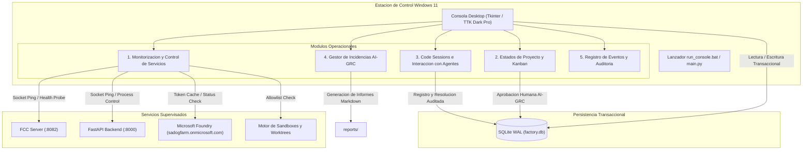
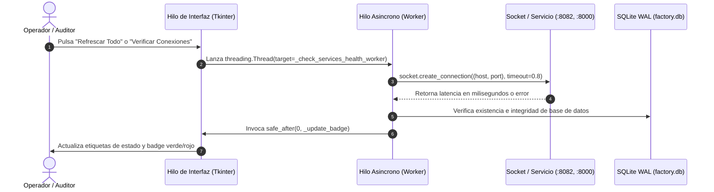
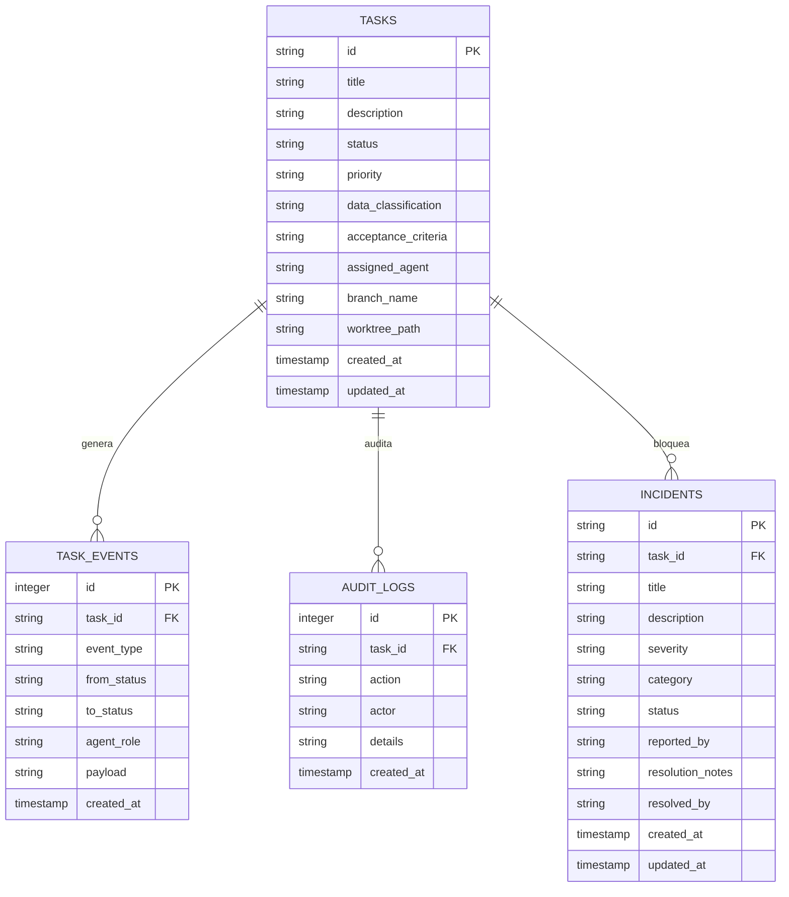

# Arquitectura Tecnica de la Consola de Gestion Integral de Escritorio

## 1. Vision General

La **Consola de Gestion Integral de Escritorio** (`Console-AI-Dev-Infrastructure`) es la aplicacion de mando centralizada desarrollada para estaciones de trabajo Windows. Proporciona a los directores tecnicos, operadores de sistemas y auditores de cumplimiento AI-GRC una interfaz grafica nativa, reactiva y desacoplada para supervisar y gobernar la infraestructura de factoria de software con inteligencia artificial (`Autonomous-AI-Dev-Infrastructure`) y sus proyectos satelite como *Livestock Manager*.

---

## 2. Modelo de Concurrencia y Eventos de la Interfaz

Para asegurar una experiencia de usuario fluida y evitar el bloqueo del hilo principal de renderizado grafico en Windows, la consola implementa una arquitectura basada en **hilos de trabajo asincronos (background worker threads)** y enrutamiento seguro mediante el bucle de eventos de Tkinter:

1. **Bucle Principal (Main GUI Thread):** Gestiona exclusivamente la interfaz visual, eventos de raton y teclado, y redibujado de paneles y tablas `Treeview`.
2. **Hilos de Telemetria (Healthcheck Workers):** Comprueban periódicamente la disponibilidad de puertos (`8082`, `8000`), latencias de red y estado del archivo SQLite mediante sockets no bloqueantes.
3. **Despacho Seguro (`safe_after`):** Los hilos secundarios nunca interactúan directamente con los widgets de la interfaz; en su lugar, delegan la mutación visual mediante `self.safe_after(delay_ms, callback)`, garantizando la integridad del árbol de widgets ante condiciones de carrera.

---

## 3. Diseno Modular de la Aplicacion

### Modulo 1: Monitorizacion y Control de Servicios
- **FCC Server (Localhost 8082):** Verificacion de conectividad con el proxy local de modelos de inferencia. Proporciona boton para consultar `/v1/models` y comprobar el catalogo de 4.405 modelos.
- **FastAPI Backend (Localhost 8000):** Comprobacion del backend REST de la Software Factory. Permite lanzar el servidor uvicorn en un subproceso de Windows o detenerlo de forma controlada.
- **Persistencia SQLite WAL:** Confirmacion del archivo `factory.db`, verificacion del modo Write-Ahead Logging (WAL) y soporte para transacciones concurrentes.
- **Microsoft Foundry Hub (`sadogfarm.onmicrosoft.com`):** Estado del Hub empresarial *Sdog Farm Software Factory* y despliegues `sdogfarm-gpt4o`, `sdogfarm-phi4` y `sdogfarm-gpt4o-mini`.
- **Motor de Sandboxes y Worktrees:** Verificacion de politicas de aislamiento de comandos y creacion de ramas efimeras de desarrollo.

### Modulo 2: Estados de Proyecto y Tablero Kanban
- **Ciclo de Estados:** Mapea el flujo de trabajo formal: `BACKLOG` -> `TODO` -> `IN_PROGRESS` -> `IN_REVIEW` -> `APPROVAL_PENDING` -> `DONE`.
- **Inspeccion de Tareas:** Muestra titulo, descripcion, prioridad (`low`, `medium`, `high`, `critical`), clasificacion de datos AI-GRC (`approved_remote`, `restricted`, `local_only`), rama git, criterios de aceptacion y log historico de transiciones.
- **Puerta de Enlace Humana (Human-in-the-Loop Barrier):** Implementa la barrera de aprobacion obligatoria antes de autorizar la promocion de cualquier tarea a `DONE`.

### Modulo 3: Code Sessions e Interaccion con Agentes
- **Hub Web de FCC (:8082/admin/code):** Apertura en navegador del centro de sesiones de código de FCC.
- **Lanzadores de Terminal:** Ejecución desacoplada de sesiones CLI de Claude Code (`launch_fcc_client.bat`) y Aider/Codex con variables de entorno de proxy loopback preconfiguradas.
- **Consola Interactiva de Agentes:** Inyección de System Prompts especializados por rol (Arquitecto, Analista, Full-Stack, QA Tester, Auditor AI-GRC, Project Manager), selección dinámica de modelos con prioridad gratuita (`kilo/kilo-auto/free`, `kilo/openrouter/free`, `open_router/openrouter/free`, `openrouter/auto`) y comerciales (`claude-3-5-sonnet-20241022`, `gpt-4o`). Ejecuta llamadas asíncronas HTTP a `/v1/messages` y almacena eventos forenses en SQLite WAL (`AGENT_INTERACTIVE_SESSION`).

### Modulo 4: Gestor de Incidencias Operacionales y AI-GRC
- **Deteccion y Registro:** Captura violaciones de politicas de seguridad, deteccion de credenciales o secretos (`SecretScanner`), excepciones en el sandbox de comandos y fallos de orquestacion.
- **Triaje por Severidad:** Categorizacion en `critical`, `high`, `medium` y `low`.
- **Resolucion Auditada:** Formulario para documentar la causa raiz y las acciones correctoras, guardando la firma del operador y la fecha de resolucion.

### Modulo 5: Registro de Eventos, Auditoria y Exportacion Forense
- **Stream de Eventos:** Visualizacion de transiciones en `task_events` y de acciones de seguridad en `audit_logs`.
- **Exportador Forense Markdown:** Genera informes ejecutivos estructurados en `reports/informe_auditoria_aigrc_<timestamp>.md` con tablas de metricas, distribucion de estados Kanban, inventario de incidencias y firmas humanas registradas.

---

## 4. Esquema de Datos y Persistencia

La consola opera sobre cuatro tablas relacionales normalizadas en SQLite:

---

## 5. Integracion Empresarial con Microsoft Azure AI Foundry

La consola esta configurada para integrarse con el Hub empresarial de *Sdog Farm*:
- **Tenant:** `sadogfarm.onmicrosoft.com`
- **Hub:** `Sdog Farm Software Factory`
- **Region y Custodia:** `spaincentral` / `westeurope` bajo la garantia **EU Data Boundary** (Reglamento General de Proteccion de Datos e ISO/IEC 42001).
- **Control de Rutas:** Las tareas con clasificacion `local_only` se restringen al entorno local (FCC Server / CPU local), mientras que las tareas marcadas como `approved_remote` son habilitadas para inferencia en Microsoft Foundry.
